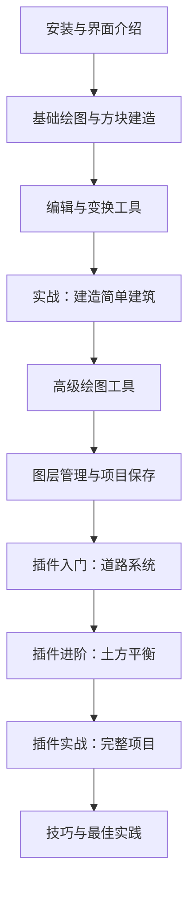

# Plot 视频教程体系架构

## 教程定位

### 目标受众
- **主要受众**：Minecraft 玩家，熟悉基本游戏操作，希望使用 Plot 进行精确建造
- **次要受众**：对 CAD 类工具感兴趣的建筑师、规划师，想在 Minecraft 中实现专业设计
- **技能水平**：入门到进阶（从零基础到掌握高级功能与插件）

### 教学目标
1. **快速上手**：15 分钟内让用户能够绘制基本图形并转换为方块
2. **工具掌握**：系统学习所有绘图和编辑工具的使用方法
3. **实战应用**：通过实际建造案例掌握 Plot 的完整工作流程
4. **进阶技巧**：熟练使用插件系统完成复杂的建造项目

### 教程特色
- **循序渐进**：从简单到复杂，每个视频都有明确的学习目标
- **实战导向**：每章都包含实际建造案例，不只是功能演示
- **中英双语**：支持中英文字幕，面向全球 Minecraft 社区
- **可视化强**：大量操作演示，配合关键参数的屏幕标注

---

## 教程结构

### 总体框架（三大模块）

```
Plot 视频教程
│
├── 第一模块：基础入门（3-5 集，约 60 分钟）
│   └── 目标：让用户能独立完成简单建筑的 2D 规划和方块建造
│
├── 第二模块：工具精通（8-10 集，约 120 分钟）
│   └── 目标：掌握所有绘图和编辑工具，灵活运用各种变换
│
└── 第三模块：插件与实战（5-7 集，约 100 分钟）
    └── 目标：使用插件完成道路、地形整平、建筑等复杂项目
```

### 学习路径



---

## 难度分级

| 级别 | 内容范围 | 目标 |
|------|----------|------|
| **入门级** | 安装、界面、基础工具、简单建造 | 能独立绘制图形并转换为方块 |
| **进阶级** | 所有工具详解、变换、图层管理 | 熟练使用所有工具完成中等复杂度设计 |
| **高级** | 插件系统、复杂项目实战 | 能规划和建造道路、地形、大型建筑 |

---

## 内容覆盖矩阵

| 功能模块 | 基础入门 | 工具精通 | 插件与实战 |
|---------|---------|---------|-----------|
| 界面与设置 | ✓✓✓ | ✓ | - |
| 基础绘图工具 | ✓✓✓ | ✓✓ | ✓ |
| 编辑与变换 | ✓✓ | ✓✓✓ | ✓ |
| 方块建造 | ✓✓✓ | ✓✓ | ✓✓✓ |
| 图层管理 | ✓ | ✓✓ | ✓ |
| 吸附与网格 | ✓✓ | ✓✓✓ | ✓ |
| 道路系统 | - | - | ✓✓✓ |
| 土方平衡 | - | - | ✓✓✓ |
| 建筑生成器 | - | - | ✓✓✓ |
| 图案生成器 | - | - | ✓✓ |
| 电力线路 | - | - | ✓✓ |

**图例**：✓✓✓ 重点讲解 | ✓✓ 详细介绍 | ✓ 简单提及 | - 不涉及

---

## 视频风格与规范

### 时长控制
- **单集时长**：10-15 分钟（入门）、15-20 分钟（进阶）、20-30 分钟（实战）
- **避免**：超过 30 分钟的单集（容易让观众疲劳）
- **章节标记**：每个视频应包含时间戳章节，方便跳转

### 叙述风格
- **语速**：适中，留出观众思考和操作的时间
- **术语**：首次出现时解释，后续直接使用
- **互动**：适当提问，引导观众思考（"你觉得这里应该用什么工具？"）

### 视觉呈现
- **分辨率**：1920x1080 或 2560x1440
- **界面焦点**：重要操作时放大工具栏或参数面板
- **标注**：关键参数、快捷键用醒目文字标注
- **过渡**：使用简单过渡效果，不要过于花哨

### 音频质量
- **背景音乐**：轻柔不抢戏，建造场景可用 Minecraft 原声
- **音效**：鼠标点击等操作音效清晰可听
- **旁白**：清晰、热情，避免机械朗读

---

## 配套资源

### 示例项目文件
每个实战章节提供：
- 完整的 Plot 项目文件（JSON）
- 对应的 Minecraft 世界存档（可选）
- 关键步骤的截图图集

### 补充文档
- 工具快速参考卡（PDF）
- 快捷键速查表
- 常见问题 FAQ 文档
- 插件配置模板

### 社区互动
- 建立配套 Discord 频道或 QQ 群
- 鼓励观众分享自己的作品
- 定期收集反馈，更新教程内容

---

## 制作排期建议

### 第一阶段：基础入门（1-2 周）
- 录制 3-5 个基础视频
- 完成基本剪辑和字幕
- 先发布前 2 集测试反响

### 第二阶段：工具精通（2-3 周）
- 系统录制所有工具演示
- 准备多个建造案例素材
- 滚动发布，保持更新节奏

### 第三阶段：插件与实战（2-3 周）
- 深入录制插件教程
- 完成大型实战项目录制
- 制作完整项目演示视频

### 第四阶段：优化与推广（持续）
- 根据反馈修订内容
- 补充进阶技巧视频
- 制作精华合集或速查版

---

## 成功指标

### 观看数据
- **完播率**：>60%（入门视频）、>50%（进阶视频）
- **点赞比**：>5%
- **评论互动**：每集至少 10+ 有效讨论

### 学习效果
- **上手时间**：观众能在观看 3 集后独立完成简单项目
- **功能覆盖**：80% 的观众了解所有核心工具
- **插件使用**：50% 的观众尝试使用至少一个插件

### 社区反馈
- 收集至少 50 条建设性意见
- 建立活跃的用户社区（>200 人）
- 产出至少 10 个优秀的用户作品案例

---

## 后续扩展方向

### 进阶专题
- 性能优化技巧（大型项目）
- 自定义插件开发入门
- 与其他模组的协同使用

### 建造教学
- 不同建筑风格的 Plot 实现
- 城市规划完整流程
- 地形艺术创作

### 社区贡献
- 邀请高级用户录制客座教程
- 举办建造挑战赛
- 建立 Plot 作品展示平台
